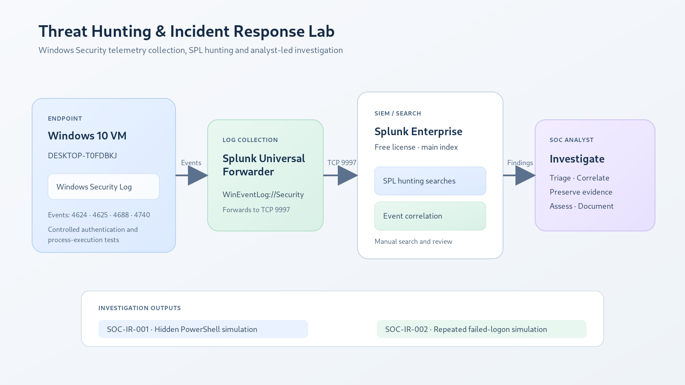

# Threat Hunting & Incident Response Lab

**Project 5 | Windows Security Auditing · Splunk Enterprise · SPL · Incident Investigation**

A hands-on SOC laboratory built with a Windows virtual machine, Splunk Universal Forwarder and Splunk Enterprise. The lab collects Windows Security telemetry, develops SPL-based hunting searches, validates process and authentication detections with controlled tests, and documents two investigation cases using an incident-response workflow.

> **Lab integrity note:** Both documented cases are controlled simulations generated on the lab endpoint. They demonstrate collection, detection and investigation methods; they are not evidence of a real compromise or an external attack.

---

## Project overview

The lab focuses on two common SOC investigation themes:

1. **Suspicious PowerShell process execution** — identify a hidden-window PowerShell execution from Windows Security Event ID 4688, inspect its command line and process lineage, and verify the executable's Authenticode result.
2. **Repeated failed logons** — analyse Windows Security Event ID 4625 records, aggregate failed attempts, interpret authentication status/substatus, check for a subsequent successful logon, and investigate account-lockout evidence.

The work is documented in two incident reports and a reusable incident-response playbook.

## Lab architecture



**Data flow:** Windows 10 VM → Splunk Universal Forwarder → TCP receiver on Splunk Enterprise → `main` index → SPL hunting searches → analyst investigation and documentation.

### Environment recorded during the lab

| Component | Configuration / observation |
|---|---|
| Endpoint | Windows 10 VM in Oracle VirtualBox |
| Endpoint hostname | `DESKTOP-T0FDBKJ` |
| Log collector | Splunk Universal Forwarder on the Windows VM |
| SIEM / search platform | Splunk Enterprise Free on the host |
| Splunk index | `main` |
| Security sourcetype | `WinEventLog:Security` |
| Forwarding destination | `192.168.56.1:9997` |
| Connectivity check | `Test-NetConnection 192.168.56.1 -Port 9997` returned `TcpTestSucceeded: True` |
| Windows VM host-only address observed | `192.168.56.109` |
| Local failed-logon source address | `127.0.0.1` (loopback / localhost) |

The Windows VM also had a separate NAT/internet interface during setup. The exact VM interface addresses can change when VirtualBox networking is reconfigured; the values above are the addresses captured during this lab session.

## Telemetry collected

| Event ID | Windows event | How it was used |
|---:|---|---|
| 4624 | An account was successfully logged on | Correlate failed logons with subsequent successful authentication |
| 4625 | An account failed to log on | Identify and aggregate failed authentication attempts |
| 4688 | A new process has been created | Inspect process names, command lines, creator processes and PIDs |
| 4740 | A user account was locked out | Check whether the repeated failed-logon sequence produced a lockout event |

Windows Security events were forwarded into Splunk's `main` index. Process command-line data was available in the observed Event ID 4688 records.

## Detection engineering

### 1. Suspicious PowerShell execution

The SPL search looks for selected command-line indicators including encoded-command options, hidden-window execution, execution-policy bypass, `DownloadString` and `FromBase64String`.

**Validation performed:**

- A controlled hidden PowerShell test using `-WindowStyle Hidden` was detected.
- A normal PowerShell test was not flagged by the selected indicators.
- The detected event was inspected in Splunk and correlated to its parent process and process IDs.
- The test command wrote only a harmless marker string: `Project5 detection test`.

### 2. Failed-login burst hunting

The lab identified six Event ID 4625 records for the `SOCTestUser` test account between `09:09:13.662` and `09:12:13.966` on November 4, 2026. The source was `127.0.0.1`, and the logon type was `2` (Interactive).

The failed-login events showed:

- Status: `0xC000006D` — general logon failure.
- SubStatus: `0xC000006A` — wrong-password status in the observed authentication context.
- Failure reason text: `Unknown user name or bad password.`

The failed-login burst query and case-specific evidence searches are in [`detections/`](detections/).

## Investigation cases

| Case | Investigation | Key result | Disposition |
|---|---|---|---|
| [SOC-IR-001](investigations/SOC-IR-001/report.md) | Simulated hidden PowerShell execution | Event 4688 at `12:23:00.720`; user `mn943`; parent PowerShell PID `0x1f04`; new process PID `0x209c`; command line included `-WindowStyle Hidden` | Benign controlled simulation; no compromise established |
| [SOC-IR-002](investigations/SOC-IR-002/report.md) | Simulated repeated failed logons | Six Event 4625 attempts against `SOCTestUser`; loopback source; wrong-password substatus | Benign controlled simulation; no compromise established |

### SOC-IR-001 — key evidence

- Timestamp: `2026-11-04 12:23:00.720`
- Event ID: `4688`
- Account: `mn943`
- Parent process: `C:\Windows\System32\WindowsPowerShell\v1.0\powershell.exe`
- Parent process ID: `0x1f04`
- New process: `C:\Windows\System32\WindowsPowerShell\v1.0\powershell.exe`
- New process ID: `0x209c`
- Record number: `66675`
- Command line: `-NoProfile -WindowStyle Hidden -Command "Write-Output 'Project5 detection test'"`

The parent and child were both PowerShell processes. The activity was deliberately generated as a harmless detection test. The hidden-window switch is a hunting indicator, not proof of malicious intent.

### SOC-IR-002 — key evidence and limitation

- Failed attempts: `6`
- First attempt: `2026-11-04 09:09:13.662`
- Last attempt: `2026-11-04 09:12:13.966`
- Target account observed in event data: `SOCTestUser`
- Source: `127.0.0.1` (localhost)
- Logon type: `2` (Interactive)
- Status / SubStatus: `0xC000006D` / `0xC000006A`
- No matching successful logon for `SOCTestUser` was returned in the `09:05–09:20` investigation window.
- No Event ID 4740 was found in the local Security log or corresponding Splunk search for the examined period.

The `net accounts` output showed a lockout threshold of five attempts, a ten-minute lockout duration and a ten-minute observation window. A later CIM check showed the account enabled and currently not locked out. **The account's historical lockout state during the earlier failed-logon sequence remains unconfirmed.** No lockout event was observed, so this project does not claim that a lockout occurred.

## Incident response playbook

The playbook covers preparation, detection, triage, process and authentication analysis, containment decisions, recovery, evidence preservation and closure.

[Read the Incident Response Playbook](docs/incident-response-playbook.md)

## Repository contents

```text
threat-hunting-incident-response-lab/
├── README.md
├── architecture/
│   ├── lab-architecture.svg
│   └── lab-architecture.png
├── docs/
│   ├── lab-setup.md
│   ├── detection-catalog.md
│   └── incident-response-playbook.md
├── detections/
│   ├── failed-login-burst.spl
│   ├── suspicious-powershell-execution.spl
│   └── investigations/
│       ├── soc-ir-001-exact-event.spl
│       ├── soc-ir-001-timeline.spl
│       ├── soc-ir-002-failed-login-summary.spl
│       ├── soc-ir-002-successful-login-check.spl
│       └── soc-ir-002-lockout-check.spl
├── investigations/
│   ├── SOC-IR-001/
│   │   └── report.md
│   └── SOC-IR-002/
│       └── report.md
└── evidence/
    ├── README.md
    ├── 01-lab-setup-and-forwarder/
    ├── 02-authentication-hunting/
    ├── 03-process-and-powershell-hunting/
    ├── 04-incident-correlation/
    └── 05-policy-and-signature-verification/
```

## Publishing to GitHub

The package includes an [upload guide](UPLOAD-TO-GITHUB.md) with Git and GitHub Desktop instructions. Review the lab identifiers shown in screenshots before publishing the repository publicly.

## Reproducing the lab

1. Create an isolated Windows VM in VirtualBox and configure a host-only network for communication with the Splunk host.
2. Install Splunk Enterprise on the host and enable the receiving port `9997`.
3. Install Splunk Universal Forwarder on the Windows VM.
4. Configure the forwarder to send to the Splunk receiver and collect the Windows Security event log into the `main` index.
5. Enable the required Windows audit policies. Confirm that failed logons and process creation are recorded.
6. Verify the TCP connection to the receiver and confirm that `WinEventLog:Security` events arrive in Splunk.
7. Run the detection searches in `detections/` and compare results with the documented controlled tests.

Configuration examples and validation commands are provided in [`docs/lab-setup.md`](docs/lab-setup.md).

## Limitations and scope

- Splunk Enterprise Free was used. In this lab instance, alert creation and scheduled alerting were unavailable, so detections were executed and reviewed manually.
- The project uses a single Windows endpoint and locally generated test activity; it does not demonstrate a multi-host production SOC or a confirmed remote attack.
- The failed-login events used `127.0.0.1`, so they must not be described as originating from an external attacker.
- The lockout policy and missing Event ID 4740 create an unresolved historical-state discrepancy. The report preserves this as a limitation rather than inferring a lockout.
- The process-signature command returned `Status: Valid` and a Microsoft Windows signer subject. The certificate details displayed a `Not After` date of June 17, 2026, earlier than the November 4, 2026 investigation date. The lab records the command output as observed but does not independently reconcile the timestamp/certificate-validity detail; revalidation with an appropriate trusted signature-verification workflow is recommended.
- The severity label `Medium` in the PowerShell search is assigned by the SPL query for demonstration; it is not a vendor-calculated risk score.

## Evidence gallery

All uploaded screenshots from the November 3–4, 2026 lab sessions have been retained and grouped by stage. Some images are intermediate scroll captures or repeated views of the same search result; they are preserved as session evidence. See the [Evidence Index](evidence/README.md) for the capture groups and representative screenshots.

## References

- [Microsoft: Event 4625 — An account failed to log on](https://learn.microsoft.com/en-us/previous-versions/windows/it-pro/windows-10/security/threat-protection/auditing/event-4625)
- [Microsoft: Event 4688 — A new process has been created](https://learn.microsoft.com/en-us/windows/security/threat-protection/auditing/event-4688)
- [Microsoft: Event 4740 — A user account was locked out](https://learn.microsoft.com/en-us/previous-versions/windows/it-pro/windows-10/security/threat-protection/auditing/event-4740)
- [Microsoft: NTSTATUS values — `STATUS_WRONG_PASSWORD`](https://learn.microsoft.com/en-us/openspecs/windows_protocols/ms-samr/7440cfac-6052-4925-84e4-c32e417de300)

---

**Authoring note:** Case details are based on the lab screenshots and recorded command outputs. Findings are intentionally limited to what the captured evidence supports.
